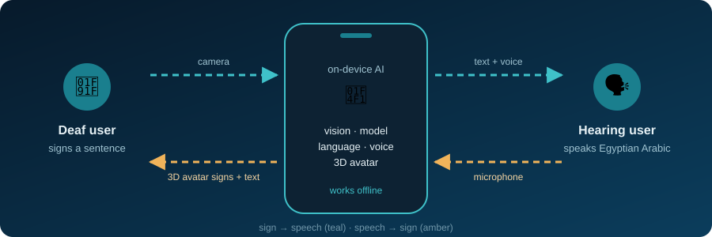
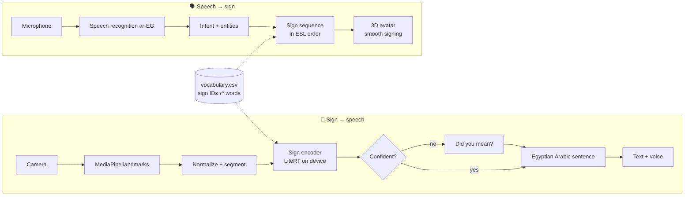

<p align="center">
  
  
  
  
  
  
  
  
</p>

<p align="center">
  <b>A graduation project that lets a Deaf person and a hearing person talk face to face, without an interpreter.</b>
</p>

---

## 📑 Contents

- [The idea](#-the-idea)
- [How it works](#-how-it-works)
- [Architecture](#-architecture)
- [What makes it different](#-what-makes-it-different)
- [Tech stack](#-tech-stack)
- [Project structure](#-project-structure)
- [Documentation](#-documentation)
- [Roadmap](#-roadmap)
- [Team](#-team)
- [Getting started](#-getting-started)
- [Acknowledgements](#-acknowledgements)

---

## 💡 The idea

Most hearing people in Egypt do not know sign language, and many Deaf people cannot read Arabic well. A text-only app does not solve the problem, and a human interpreter is not always available.

This app translates **whole sentences in both directions**, in one real-life situation first: **clinic reception**.

| Direction | What happens |
|---|---|
| 🤟 **Sign → speech** | The Deaf person signs in front of the camera. The app recognizes the signs, writes a natural **Egyptian Arabic sentence**, and **speaks it aloud**. |
| 🗣️ **Speech → sign** | The hearing person speaks Egyptian Arabic. The app shows the text and a **3D avatar signs the sentence** as one smooth movement. |

---

## ⚙️ How it works

<p align="center">
  
</p>

**Sign → speech:** camera → MediaPipe hand, body and face landmarks → normalization → sign segmentation → on-device sign encoder → "Did you mean?" when unsure → Egyptian Arabic sentence → voice.

**Speech → sign:** microphone → Egyptian Arabic speech recognition → understanding (intent + entities) → sign sequence in sign-language order → 3D avatar with facial grammar + text.

---

## 🏗️ Architecture



Nothing about specific signs is hard-coded: every sign lives in `vocabulary.csv`, the model files, and the phrase tables. Moving from the starting dataset to Egyptian data means retraining, not rewriting the app.

---

## ✨ What makes it different

- **Sentences, not single words**, in **both directions**
- **3D avatar** output for Deaf users who cannot read, with question and negation facial expressions
- **Works for new people:** evaluated on signers the model has never seen (Leave-One-Signer-Out)
- **"My Signs":** users add their own signs instantly and share them for approval, building an Egyptian sign dictionary together
- **Egyptian Arabic end to end:** speech recognition, sentences, and voice
- **Safe by design:** asks "Did you mean?" when unsure, rejects non-signs, emergency alerts
- **Offline and private:** recognition runs on the phone; video never leaves it without consent

---

## 🛠️ Tech stack

| Area | Tools |
|---|---|
| Vision | MediaPipe Tasks (Hand, Pose, Face), OpenCV |
| Machine learning | Python, PyTorch or TensorFlow, scikit-learn, Weights & Biases |
| On-device | LiteRT (`.tflite`) |
| Speech & language | Android SpeechRecognizer (ar-EG), Whisper, rapidfuzz, sentence-transformers |
| 3D avatar | Blender, glTF, three.js |
| Mobile app | Kotlin, Jetpack Compose, CameraX, Media3, Room |
| Backend | Firebase |

<p align="center">
  
</p>

---

## 📁 Project structure

```
esl-two-way-translator/
├── data-pipeline/   datasets, vocabulary, splits, adapter        (Data & Evaluation)
├── data/            vocabulary.csv, metadata.csv, splits (small files only)
├── cv/              landmark extraction, features, segmentation  (Computer Vision)
├── ml/              training, evaluation, model export           (Machine Learning)
├── android/         the mobile app                               (Mobile App)
├── nlp/             speech, intents, sentences, voice            (Speech & NLP)
├── avatar/          3D character, animations, viewer             (3D Avatar)
├── docs/
│   ├── contracts/   C1–C11: what each role hands to the others (schemas + examples)
│   ├── decisions.md every decision and why
│   ├── feature_spec.md   exact feature layout (C4)
│   └── en/ ar/ pdf/ project documents (EN + AR)
├── scripts/         validate_contracts.py (runs in CI)
├── .github/         issue templates, PR template, CI, CODEOWNERS
├── CLAUDE.md        project context for AI coding tools (AGENTS.md points here)
└── assets/          images for this README
```

Every role folder has a README: what it delivers, what it receives, its layout and its first two weeks.

## 🤝 How we work

1. **Pick or open an issue** (Task / Bug / Contract change templates), with your role and "done when".
2. **Branch** from `main`, commit small, open a **pull request**; someone from a different role reviews.
3. **Contracts** in [`docs/contracts/`](docs/contracts/README.md) are fixed after week 2: changing one needs a Contract change issue, the users' agreement, a version bump and an entry in [`docs/decisions.md`](docs/decisions.md).
4. **CI** checks every pull request: contracts still valid, no secrets, no large data files.
5. **Weekly demo**: show what actually works.

---

## 📚 Documentation

Everyone reads **document 00** once, then works from their own role document.

| Document | English | العربي |
|---|---|---|
| 00 — Project Master Document | [PDF](docs/pdf/en/00_Project_Master_Document.pdf) | [PDF](docs/pdf/ar/00_Project_Master_Document.pdf) |
| 01 — Data & Evaluation Engineer | [PDF](docs/pdf/en/01_Data_and_Evaluation_Engineer.pdf) | [PDF](docs/pdf/ar/01_Data_and_Evaluation_Engineer.pdf) |
| 02 — Computer Vision Engineer | [PDF](docs/pdf/en/02_Computer_Vision_Engineer.pdf) | [PDF](docs/pdf/ar/02_Computer_Vision_Engineer.pdf) |
| 03 — Machine Learning Engineer | [PDF](docs/pdf/en/03_Machine_Learning_Engineer.pdf) | [PDF](docs/pdf/ar/03_Machine_Learning_Engineer.pdf) |
| 04 — Mobile App Engineer | [PDF](docs/pdf/en/04_Mobile_App_Engineer.pdf) | [PDF](docs/pdf/ar/04_Mobile_App_Engineer.pdf) |
| 05 — Speech & NLP Engineer | [PDF](docs/pdf/en/05_Speech_and_NLP_Engineer.pdf) | [PDF](docs/pdf/ar/05_Speech_and_NLP_Engineer.pdf) |
| 06 — 3D Avatar Engineer | [PDF](docs/pdf/en/06_3D_Avatar_Engineer.pdf) | [PDF](docs/pdf/ar/06_3D_Avatar_Engineer.pdf) |

Sources are in `docs/en` and `docs/ar`; see [docs/README.md](docs/README.md) to rebuild the PDFs.

---

## 🗺️ Roadmap

- [x] Project plan, role documents, and repo
- [ ] **Weeks 1–2:** feasibility spikes and frozen contracts
- [ ] **Month 1:** 50 signs selected, live landmarks in the app
- [ ] **Month 2:** first model in the app, first unseen-signer results
- [ ] **Month 3:** sign → speech working on the phone
- [ ] **Month 4:** complete two-way product (conversation mode, avatar sentences)
- [ ] **Month 5:** My Signs, context-aware vocabulary, user testing
- [ ] **Month 6:** feature freeze, report, demo, defense

---

## 👥 Team

| Role | Member |
|---|---|
| 🗂️ Data & Evaluation Engineer |Momen - Ahmed - Habiba |
| 👁️ Computer Vision Engineer |Alaa - Aya - Mahmoud |
| 🧠 Machine Learning Engineer |Momen - Ahmed - Habiba |
| 📱 Mobile App Engineer |Alaa - Aya - Mahmoud |
| 🗣️ Speech & NLP Engineer |Momen - Ahmed - Habiba|
| 🧍 3D Avatar Engineer | Alaa - Aya - Mahmoud |

---

## 🚀 Getting started

The code is being built. For now you can rebuild the documentation:

```bash
git clone https://github.com/Alaa-Alyy/esl-two-way-translator.git
cd esl-two-way-translator
pip install markdown
python docs/build.py
```

Setup steps for the app, training, and data pipeline will be added here as each part lands.

---

## 🙏 Acknowledgements

- **KArSL** Arabic Sign Language database (Sidig et al., 2021), used as the starting dataset
- **MediaPipe**, **LiteRT**, and the open-source tools listed above
- The Deaf community and interpreters who help verify signs and test the app


